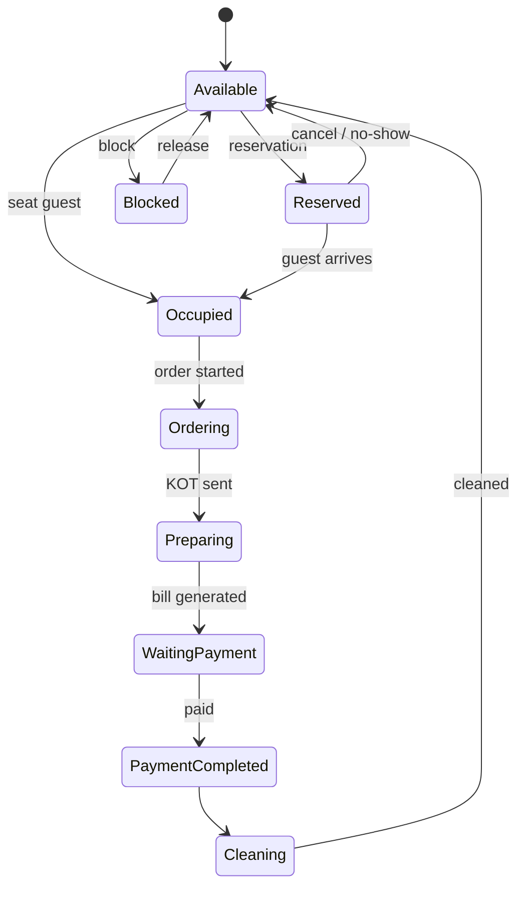
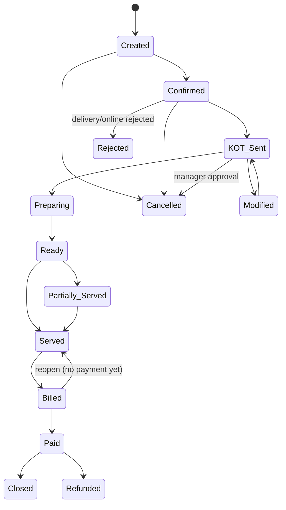

# Restaurant POS — Intern 1: Order & Front-of-House Operations

**Scope:** Table → Menu → Order → Lifecycle → KOT → Kitchen → Dine-in / Takeaway / Delivery.
Billing/payment (Intern 2), inventory (Intern 3), RBAC (Intern 4) and architecture (Intern 5) are only referenced as integration points.

---

## 1. Table Workflow

**Fields:** table_id, branch_id, table_number, floor/section, capacity, status, current_order_id, version.

**States:** Available, Reserved, Occupied, Ordering, Preparing, Waiting for Payment, Payment Completed, Cleaning, Blocked.



**Operations**
- **Create:** unique table number per branch + floor.
- **Assign:** attach guest count / customer to table, status → Occupied.
- **Transfer:** move the open order(s) from Table A to Table B (B must be Available). A → Cleaning/Available, B takes A's state. Open KOTs stay valid and the kitchen is notified of the new table number.
- **Merge:** combine Table A + B into one active order (both Occupied). Items are merged into the primary table's order and the secondary table is linked as "merged". A merged order is **not** allowed if either has a Billed/Paid state.
- **Block / Release:** Manager-only, reason mandatory; cannot block an Occupied table.

---

## 2. Menu Workflow

**Entities:** Category → Item → Modifier Groups → Modifiers.

**Item fields:** item_id, name, category_id, description, image_url, base_price, tax_category_id, prep_time_min, kitchen_station, is_active, availability rules.

**Availability rules (item is orderable only if ALL pass):**
1. `is_active = true`
2. Branch availability (item mapped to this branch)
3. Time-slot rule (Breakfast 07:00–11:00, Lunch 12:00–16:00, Dinner 18:00–23:00)
4. Day rule (e.g. weekend special)
5. Stock flag from Inventory (Intern 3) = in stock
6. No temporary "86'd" flag set by Manager/Kitchen

**Modifiers:** Extra cheese, Extra patty, No onion, No tomato, Spicy, Combo upgrade.
Group fields: min_select, max_select, is_required. Modifier fields: name, extra_price, max_qty, is_available.

**Rule:** Price change never alters old orders — the order item stores a **price snapshot**.

---

## 3. Order Workflow

```
Create Order → Select Order Type → Select Table / Customer → Add Items
→ Modifiers → Notes → Confirm → KOT
```

**Supported actions:** create, add/remove item, change quantity, add modifier, customer note, modify, cancel, reopen (eligible), history, status view.

**Order types:** Dine-in (table required), Takeaway (customer name/phone), Delivery (customer + address + platform/phone).

**Order fields:** order_id, order_no, branch_id, order_type, table_id, customer_id, status, source (POS/phone/online/platform), created_by, created_at, version, request_id.
**Order item fields:** order_item_id, item_id, name_snapshot, price_snapshot, qty, modifiers[], note, status, kot_id.

---

## 4. Order Lifecycle / State Diagram



**Alternative states:** Cancelled, Rejected, Modified, Partially Served, Refunded.

**Rules**
- Only forward transitions are allowed, except the explicit ones above.
- **History is never overwritten.** Every change inserts a row in `order_status_history` (old_status, new_status, changed_by, reason, timestamp).
- Closed orders are immutable; corrections happen via refund / adjustment records.
- Billed → Paid → Closed transitions are triggered by Intern 2's billing/payment events.

---

## 5. KOT Workflow

```
Order Confirmed → KOT Created (per station) → Sent to Printer/KDS
→ Accepted → Preparing → Ready → Served
```

**KOT:** kot_id, kot_no, order_id, station, priority (Normal/High/Rush), status, sent_at, accepted_at, ready_at, version.
**KOT item:** kot_item_id, order_item_id, qty, modifiers, note, status.
**KOT status:** Pending, Sent, Accepted, Preparing, Ready, Served, Cancelled, Failed.

**Rules**
- One order can produce multiple KOTs (initial + additions) and multiple stations split automatically by item station.
- **Add items after KOT:** new KOT (marked "ADDITION") — old KOT untouched.
- **Modify/cancel after KOT:** creates a **modification/cancel KOT** shown on kitchen as a change alert; if item is already Preparing, cancellation requires Manager approval and is recorded as potential wastage.
- KOT failure (printer/KDS down): status Failed → auto retry 3 times → fallback to alternate printer/KDS → alert on waiter + manager dashboard; order must **not** be lost.

---

## 6. Kitchen Workflow

**Stations:** Main Kitchen, Grill, Bakery, Beverage, Dessert.

```
KOT arrives at station KDS → Chef accepts → Preparing → Ready
→ Waiter notified → Pickup → Served
```

- Priority ordering: Rush > High > Normal, then oldest first.
- Delay rule: if elapsed > item prep_time × 1.25 → flagged "Delayed" (alert to Manager/Waiter).
- Station can mark an item **Unavailable** → event to Menu + Inventory, waiter alerted, item removed from order via modification flow.
- Order becomes **Ready** when all KOT items across stations are Ready; if only some are served → Partially Served.

---

## 7. Dine-in Workflow

```
Guest seated → Table Occupied → Order created → Items + modifiers → Confirm
→ KOT(s) → Kitchen prepares → Ready → Served (partial allowed)
→ Bill requested → Billed → Payment → Paid → Table Cleaning → Available
```
Table status mirrors order status (see §1). Additional rounds of ordering are allowed until the bill is generated.

## 8. Takeaway Workflow

```
Customer → POS Order (name/phone) → Confirm → KOT → Kitchen → Ready
→ Payment → Handover → Closed
```
Payment can be taken at order time (prepaid) or at handover. Order is Closed only after handover **and** payment. Ready orders uncollected after configurable time (e.g. 30 min) trigger a reminder to the cashier.

## 9. Delivery Workflow

```
Online / Phone / Platform → POS Order → Accept/Reject → KOT → Kitchen → Ready
→ Delivery Assignment → Dispatched → Delivered → Payment/Settlement → Closed
```

**Three separate statuses (never mix them):**

| Status | Owner | Values |
|---|---|---|
| Order status | Order module | Created … Closed |
| Delivery status | Delivery sub-module | Pending, Assigned, Dispatched, Delivered, Failed, Returned |
| Payment status | Billing (Intern 2) | Unpaid, Pending, Paid (prepaid/COD/platform), Settled |

**Interaction rules**
- Order can only move to **Closed** when Delivery = Delivered **and** Payment = Paid/Settled.
- Prepaid online: Payment = Paid at creation; COD: Paid after Delivered (cash collected by rider); platform orders: Paid, Settled later via platform settlement.
- Delivery Failed/Returned → order goes to a manager-review path (cancel, redeliver or refund).
- Platform order rejected within SLA → state Rejected with reason sent back to the platform.

---

## 10. Order Business Rules

1. Dine-in needs a table; Takeaway needs customer name or phone; Delivery needs address + phone.
2. An order needs at least 1 item to be Confirmed.
3. Modifier selection must satisfy min/max select of the group.
4. Unavailable items cannot be added (hard block, not warning).
5. Quantity must be > 0; max qty per item configurable.
6. Before Confirmed: free editing. After KOT: changes generate KOT modification.
7. Cancel before KOT: any permitted user with a reason. Cancel after KOT: Manager approval + reason.
8. Served items cannot be removed — only refunded/adjusted via billing.
9. Reopen is allowed only for Billed (unpaid) orders, with Manager approval; Paid/Closed orders cannot be reopened (use refund).
10. Every status change, cancellation and modification is stored with user + reason + time.
11. Price snapshot is stored on the order item at add time.
12. All create/confirm/KOT requests carry a `request_id` (idempotent, see Intern 5).
13. Concurrent edit protection using `version` (optimistic locking).
14. Order numbers are sequential per branch per business day.

---

## 11. Order Database Entities

| Entity | Key columns |
|---|---|
| `tables` | id, branch_id, number, floor, capacity, status, current_order_id, version |
| `table_transfers` | id, order_id, from_table, to_table, by_user, at, reason |
| `table_merges` | id, primary_table, merged_table, order_id, at, by_user |
| `menu_categories` | id, branch_id, name, sort |
| `menu_items` | id, category_id, name, description, image, price, tax_category_id, prep_time, station, is_active |
| `menu_item_branch` | item_id, branch_id, price_override, is_available |
| `menu_time_slots` | item_id/category_id, day_of_week, start, end |
| `modifier_groups` | id, item_id, name, min_select, max_select, required |
| `modifiers` | id, group_id, name, extra_price, max_qty, is_available |
| `orders` | id, order_no, branch_id, type, table_id, customer_id, status, source, request_id, version, created_by, created_at |
| `order_items` | id, order_id, item_id, name_snap, price_snap, qty, note, status |
| `order_item_modifiers` | order_item_id, modifier_id, name_snap, price_snap, qty |
| `order_status_history` | id, order_id, old, new, by_user, reason, at |
| `order_notes` | id, order_id, note, by_user |
| `kots` | id, kot_no, order_id, station_id, priority, status, type (NEW/ADDITION/MODIFY/CANCEL), sent_at, ready_at |
| `kot_items` | id, kot_id, order_item_id, qty, status |
| `kitchen_stations` | id, branch_id, name, printer_id, kds_id |
| `deliveries` | id, order_id, platform, address, rider, status, dispatched_at, delivered_at |

---

## 12. Order / KOT APIs (module endpoints; common standard by Intern 5)

| Method | Endpoint | Purpose |
|---|---|---|
| GET/POST | `/api/v1/tables` | list / create |
| PATCH | `/api/v1/tables/{id}/status` | block / release / cleaning |
| POST | `/api/v1/tables/{id}/transfer` | transfer order |
| POST | `/api/v1/tables/merge` | merge tables |
| GET/POST/PATCH | `/api/v1/menu/categories`, `/menu/items`, `/menu/items/{id}` | menu CRUD |
| GET | `/api/v1/menu/available?branch=&time=` | currently orderable items |
| PATCH | `/api/v1/menu/items/{id}/availability` | mark unavailable |
| POST | `/api/v1/orders` | create (header `Idempotency-Key`) |
| GET | `/api/v1/orders/{id}` , `/orders?status=&type=` | view / list |
| POST | `/api/v1/orders/{id}/items` | add item |
| PATCH/DELETE | `/api/v1/orders/{id}/items/{itemId}` | change qty / remove |
| POST | `/api/v1/orders/{id}/confirm` | confirm & trigger KOT |
| POST | `/api/v1/orders/{id}/cancel` | cancel (reason) |
| POST | `/api/v1/orders/{id}/reopen` | reopen |
| POST | `/api/v1/orders/{id}/status` | lifecycle transition |
| GET | `/api/v1/orders/{id}/history` | status history |
| POST | `/api/v1/kot` | create KOT |
| GET | `/api/v1/kot?station=&status=` | KDS feed |
| PATCH | `/api/v1/kot/{id}/status` | accept / preparing / ready |
| POST | `/api/v1/kot/{id}/cancel`, `/kot/{id}/reprint` | cancel / reprint |
| POST | `/api/v1/deliveries/{orderId}/assign`, `/dispatch`, `/complete` | delivery flow |

**Events published:** `order.created`, `order.confirmed`, `order.modified`, `order.cancelled`, `kot.sent`, `kot.ready`, `order.served`, `order.billed` (consumed), `order.closed`, `item.unavailable`.
Error format: `{ "error": { "code": "ITEM_UNAVAILABLE", "message": "...", "details": {} } }`; version conflict → HTTP 409.

---

## 13. Edge-Case List

| # | Case | Handling |
|---|---|---|
| 1 | Wrong order | Cancel before KOT freely; after KOT → Manager approval, cancel KOT, log potential wastage |
| 2 | Modification after KOT | Modification KOT sent to station; old KOT marked "Modified" |
| 3 | Item becomes unavailable | Block new adds; for existing order notify waiter, offer replace/remove, record via modification |
| 4 | Table transfer | Move order + open KOTs, notify kitchen; blocked if target not Available |
| 5 | Table merge | Merge items into primary order; keep origin table on each item; block if billed |
| 6 | Partial serving | Item-level served flag; order = Partially Served until all served |
| 7 | Order cancellation | Reason + approver; kitchen notified; history kept |
| 8 | Kitchen delay | Auto flag after threshold; alert waiter/manager; customer may cancel (needs approval) |
| 9 | KOT failure | Retry → alternate printer/KDS → alert; order still saved |
| 10 | Two waiters edit same table | Version check, 2nd request gets 409 and refreshes |
| 11 | Duplicate order submit (network retry) | Same request_id returns existing order |
| 12 | Delivery platform order rejected / timeout | State Rejected, notify platform, log reason |
| 13 | Delivery failed / customer unreachable | Delivery Failed → manager decides redeliver / cancel / refund |
| 14 | Item price changed mid-order | Price snapshot keeps the old price on existing items |
| 15 | Time slot ends while order is open | Already added items stay valid; new adds are blocked |
| 16 | Modifier group limit violated | Reject with validation error |
| 17 | Order for blocked/occupied table | Reject unless same order |
| 18 | Takeaway not collected | Reminder, then Manager decision (cancel / wastage) |

---

## 14. Acceptance Criteria (Given / When / Then)

1. **Table states:** Given an Available table, when an order is created, then table becomes Occupied/Ordering and returns to Available only after Cleaning.
2. **Transfer:** Given an order on T1, when transferred to Available T2, then the order, KOTs and kitchen display show T2 and T1 is released.
3. **Merge:** Given two occupied tables, when merged, then there is one active order with all items and no item is lost.
4. **Menu time:** Given Breakfast 07:00–11:00, when it is 12:00, then Breakfast items are not orderable.
5. **Modifier rules:** When a group allows max 2 and 3 are chosen, then the system rejects the item.
6. **Order flow:** Given a valid dine-in order, when confirmed, then a KOT is created per station and order status = KOT Sent.
7. **Lifecycle:** Every status change creates a history record with user, time and reason; no history row is edited or deleted.
8. **Post-KOT change:** When an item is modified after KOT, then a modification KOT reaches the station and the original KOT is preserved.
9. **Cancel:** Cancelling after KOT without Manager approval is rejected.
10. **Idempotency:** Sending the same create-order request twice yields one order.
11. **Concurrency:** Two simultaneous edits with the same version → exactly one succeeds, other gets 409.
12. **KOT failure:** When the KOT printer is down, retries occur, an alert is raised and the order is not lost.
13. **Kitchen:** KDS shows tickets by station sorted by priority then time; delayed tickets are highlighted.
14. **Partial serving:** Marking some items served sets the order to Partially Served.
15. **Takeaway:** Order cannot be Closed before handover and payment.
16. **Delivery:** Order cannot be Closed unless Delivery = Delivered and Payment = Paid/Settled.
17. **Unavailable item:** An unavailable item cannot be added to an order.
18. **Performance (module NFR):** Order create < 1 s, KOT delivery to KDS < 2 s under normal load; works offline on local server with later sync.

---

## 15. Integration Points With Other Interns

- **Intern 2:** receives `order.served` → generates bill; sends `order.billed/paid` back to move lifecycle; merged/split bills reference order_ids.
- **Intern 3:** supplies stock availability to menu; consumes `order.confirmed/served` for recipe-based deduction; reservation ↔ table state.
- **Intern 4:** permissions for Create/Modify/Cancel/Send KOT; waiter & kitchen dashboards read order/KOT/table data; audit receives all order events.
- **Intern 5:** idempotency, offline sync queue, concurrency/locking, printer/KDS integration, API standard.
