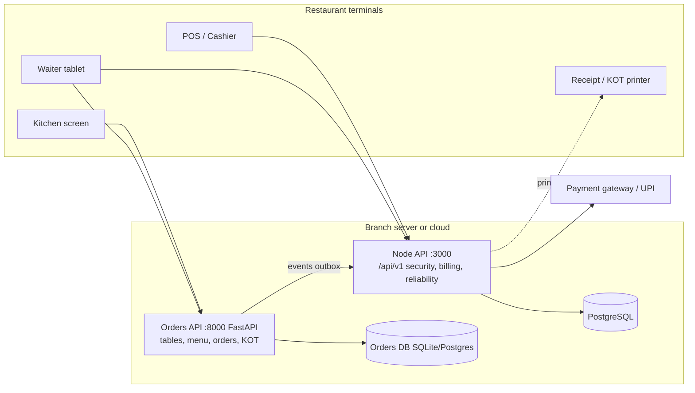

# System Architecture

## 1. Goal
A restaurant POS that keeps taking orders and payments even when the internet is down, never double-charges, and can be restored after a failure within minutes.

## 2. Components

| Component | Owner | Tech | Port |
|---|---|---|---|
| Security, RBAC, dashboards, reports, audit | Somil | Node 20+, Express 4, Prisma, PostgreSQL | 3000 |
| Billing, payments, cash shifts | Rahul | TypeScript, Express (`src/app.ts`) | via 3000 once mounted |
| Orders, KOT, kitchen, tables, menu | Prashant | Python FastAPI, SQLAlchemy, SQLite (WAL) | 8000 |
| Inventory, customers, notifications | Tia | (to be added under `backend/src/modules/`) | via 3000 |
| Health, idempotency, sync, backup | Fifth member | Node, PostgreSQL, bash | via 3000 |
| Frontend | shared | React 18, Vite, Tailwind | 5173 |

## 3. Key decisions (ADR summary)

| # | Decision | Reason | Trade-off |
|---|---|---|---|
| 1 | One PostgreSQL for all Node modules | Single backup, transactions across billing + security | Orders module still uses its own DB until migrated |
| 2 | Every state-changing request carries `Idempotency-Key` | Retries (bad Wi-Fi, double taps) must be safe | Clients must generate a UUID per user action |
| 3 | Optimistic locking with `version` + `If-Match` | Two waiters editing one order must not overwrite each other | Client must handle 409 and reload |
| 4 | Offline-first via operation queue + change log (`seq` cursor) | Simple, debuggable, works with any module | Conflicts are reported, not auto-merged |
| 5 | Event outbox (already in Orders: `/api/v1/events`) is the integration pattern between modules | Loose coupling, replay after outage | At-least-once delivery, consumers must be idempotent |
| 6 | Money is stored as integer paise | No rounding errors | Display layer converts |

## 4. Deployment

- **Single branch (default):** one small server (4 GB RAM) running Node API, Orders API and PostgreSQL via Docker Compose, on the restaurant LAN. Terminals use the LAN, so a dead internet line does not stop service.
- **Multi-branch (later):** cloud PostgreSQL + API; branch terminals keep the offline queue and sync (see `offline-sync.md`).
- Environments: `development` (demo seed users allowed), `staging`, `production` (`NODE_ENV=production`, `RELIABILITY_STORE=pg`, no demo seed).

## 5. Request path (create + pay an order)

1. Waiter taps "Send": tablet creates `Idempotency-Key`, calls Orders API (`POST /api/v1/orders`, `If-Match` on edits).
2. Orders emits `order.created` / `kot.sent` to its outbox; Kitchen screen sees it by polling `/api/v1/events/latest`.
3. Cashier opens bill: Billing reads the order, writes a bill.
4. Payment: `POST /api/billing/:id/payments` with `Idempotency-Key`; the answer is stored, so a retry returns the same result.
5. Audit record written by the security module for sensitive actions.

## 6. Failure behaviour

| Failure | What users see | What happens |
|---|---|---|
| Internet down | Nothing (LAN mode) / "Offline" badge (cloud mode) | Operations queue on the device and sync later |
| API restarts | One failed tap | Client retries with the same `Idempotency-Key`; no duplicate |
| Database down | `/health/ready` returns 503, load balancer stops traffic | Restore from backup (see `backup-recovery.md`) |
| Two users edit same order | Second gets 409 `VERSION_CONFLICT` | Screen reloads the latest order |
